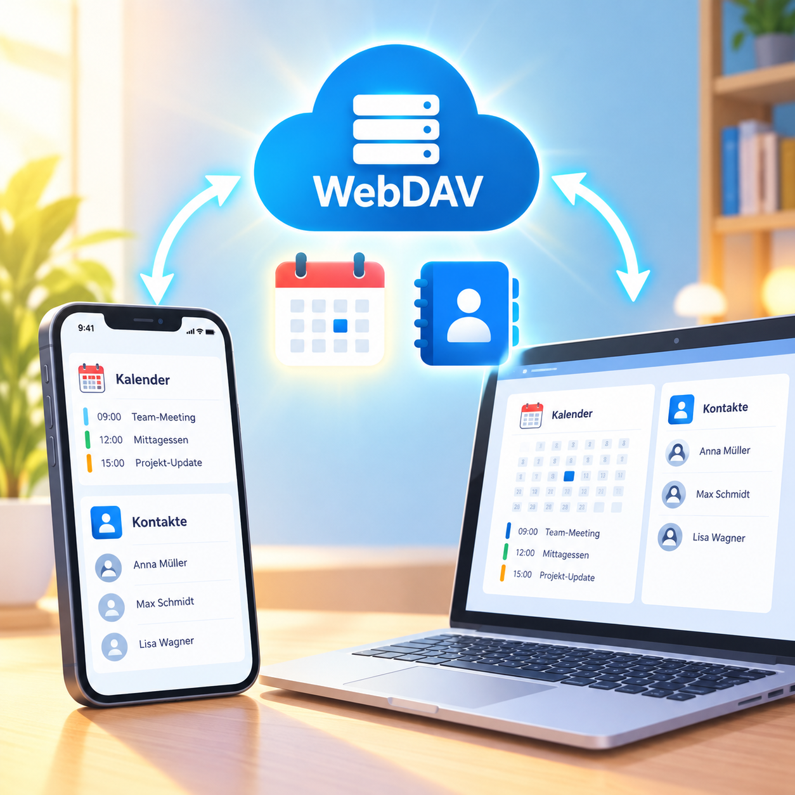

# WebDAV tutorial 2026

[](https://starlight.astro.build)



## open the tutorial

https://vanvuongngo.github.io/webdav-tutorial/


<details>
 <summary><h2>🚀 Project Structure</h2></summary>
Inside of this project, you'll see the following folders and files:

```
.
├── public/
├── src/
│   ├── assets/
│   ├── content/
│   │   └── docs/
│   └── content.config.ts
├── astro.config.mjs
├── package.json
└── tsconfig.json
```

Starlight looks for `.md` or `.mdx` files in the `src/content/docs/` directory. Each file is exposed as a route based on its file name.

Images can be added to `src/assets/` and embedded in Markdown with a relative link.

Static assets, like favicons, can be placed in the `public/` directory.
</details>

<details>
 <summary><h2>🧞 Commands</h2></summary>
All commands are run from the root of the project, from a terminal:

| Command                   | Action                                           |
| :------------------------ | :----------------------------------------------- |
| `pnpm install`             | Installs dependencies                            |
| `pnpm dev`             | Starts local dev server at `localhost:4321`      |
| `pnpm build`           | Build your production site to `./dist/`          |
| `pnpm preview`         | Preview your build locally, before deploying     |
| `pnpm astro ...`       | Run CLI commands like `astro add`, `astro check` |
| `pnpm astro -- --help` | Get help using the Astro CLI                     |
</details>

<details>
 <summary><h2>Updating Starlight</h2></summary>
```sh
pnpm dlx @astrojs/upgrade
```
</details>
